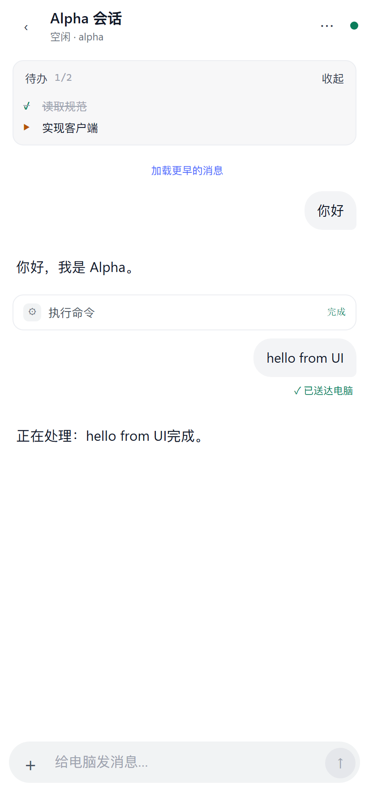
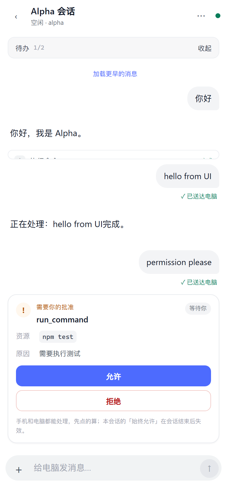
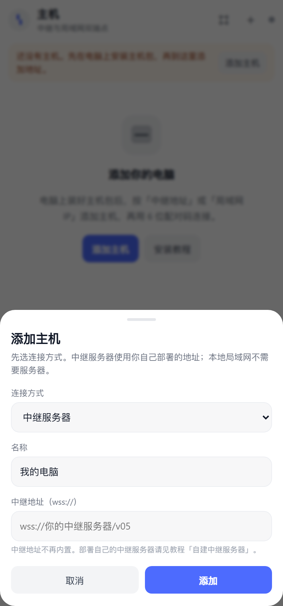

# DSH Remoto

### Your DeepSeek Harness, in your pocket — end-to-end encrypted, self-hosted, no cloud account.

[English](README.md) · [简体中文](README.zh-CN.md)


<a href="docs/screenshots/06-chat-streamed.png"></a>
<a href="docs/screenshots/07-chat-approval.png"></a>
<a href="docs/screenshots/13-add-host-relay.png"></a>

DSH Remoto is an independent Android client + Windows host service for
[DeepSeek Harness](https://github.com/deepseek-ai). It lets you read a running
session, answer approvals, send images/files and switch the permission preset
from your phone — while the DSH process stays on your computer.

The relay is **not** a cloud account and is **not** a third-party service baked
into the app. You can use the built-in local LAN relay on the same Wi-Fi, or
deploy your own relay on a VPS. The relay only forwards ciphertext; payloads are
encrypted end-to-end between the phone and the host plugin.

> **Status: beta / experimental.** The APK is signed with a self-signed test key,
> the host plugin is a patched `@dsh-remote/plugin 0.5.3`, and the project has
> not been audited. Read [Security](#security-model) before using it with
> sensitive data.

---

## Features

| Area | What you get |
| --- | --- |
| **Connectivity** | Local LAN (`ws://192.168.x.x:8787`) or your own relay (`wss://relay.example.com/v05`). Both endpoints are stored per host, with independent PSKs. |
| **Pairing** | 6-digit pair code + a 6-digit SAS fingerprint that must match on both screens. LAN can also start from a QR code. |
| **Sessions** | Running / recent / archived sessions, relative time, unread-style state dots, cache-first history. |
| **Chat** | Streaming Markdown, headings, lists, bold/italic/code, multiple message parts, collapsible tool calls, todos, retry/compaction notices. |
| **Approvals** | Inline approval cards with action, resource and reason; `Allow once`, `Always allow (session)` and `Reject`. Phone and desktop can both answer — first answer wins. |
| **Questions** | Multi-question cards with single/multi select and free-text answers. |
| **Images & files** | Send compressed images (≤512 KB total) and arbitrary files from phone to PC; receive images/files from the PC as artifact cards (≤512 KB per artifact). |
| **Permissions** | Read and change the host's DSH permission preset from the phone (read-only / workspace-write / danger-full-access). |
| **UX** | White ChatGPT-style mobile UI, auto-scroll to the latest message, thinking timer, delivery receipt, connection config export/import, keep-awake toggle. |
| **Host tooling** | One-click LAN/relay switcher, QR generator, installer/update/rollback, self-test, firewall hints, data-preserving upgrades. |

### What it is not

- Not an official DeepSeek product and not affiliated with DeepSeek.
- Not a hosted service. There is no account, no telemetry backend and no
  built-in public relay address.
- Not a replacement for DSH itself. It is a remote control surface for a DSH
  instance running on your computer.

---

## Security model

- **Pairing:** X25519 key exchange, a 6-digit SAS shown on both screens, and a
  PSK wrapped for the new channel. The phone must confirm the SAS before it
  installs the PSK. The 6-digit pair code is a capability; the QR code only
  pre-fills the address — it does **not** bypass the code or SAS.
- **Transport:** the relay forwards WebSocket frames but cannot decrypt payloads.
  Records are encrypted with XSalsa20-Poly1305; nonces use a persisted counter
  to avoid reuse across restarts.
- **Trust boundary:** the relay sees connection metadata (IPs, timing, sizes,
  host/client identifiers). The host computer must be trusted; it holds the DSH
  session and the paired PSKs.
- **Test signing:** the published 0.4.0 APK is signed with a throwaway test
  certificate (`CN=DSH Remoto Test`). The repository does **not** include its
  private keystore. Source builds use Gradle's local debug signing; replace it
  with your own release key before distributing a production app.
- **Experimental host patch:** the image-prompt fix and artifact/permission
  commands are local patches on top of `@dsh-remote/plugin 0.5.3`. A DSH plugin
  reinstall may restore the upstream package; run `run-update.bat` to restore the
  linked patched copy.

Please report security issues privately to **3309219254@qq.com** instead of
opening a public issue. See [SECURITY.md](SECURITY.md).

---

## Quick start

### 1. Download

| File | SHA-256 |
| --- | --- |
| [DSH-remoto-0.4.0.apk](releases/0.4.0/DSH-remoto-0.4.0.apk) | `6c2e7e7f…52d153c20` |
| [DSH-remoto-host-0.4.0.zip](releases/0.4.0/DSH-remoto-host-0.4.0.zip) | `5e29412c…8a649bfc` |

Full checksums: [`releases/0.4.0/SHA256SUMS.txt`](releases/0.4.0/SHA256SUMS.txt).

Requirements:

- Windows 10/11 with DeepSeek Harness installed and started at least once.
- Android 7.0+ (API 24+). No Google Play Services required.
- Same Wi-Fi for LAN mode; any internet connection for relay mode.

### 2. Install the Windows host

1. Quit DSH completely, including the tray icon.
2. Extract `DSH-remoto-host-0.4.0.zip` to a fixed folder (do not run only the
   `.bat` from inside the zip).
3. Run `run-install.bat` and wait for `Install complete`.
4. Start DSH again. A **Remote Control** pill appears at the bottom.
5. A new desktop shortcut **DSH Remoto 连接模式** is created.

The installer backs up the old plugin and keeps `user-config.json`, host id and
LAN token. It installs the patched plugin into
`%USERPROFILE%\.dsh\dsh-remote-control\plugin-patched` and links it into the DSH
profile, so installing other DSH plugins does not overwrite it.

### 3. Connect over LAN

1. Phone and PC on the same Wi-Fi.
2. Desktop shortcut → **局域网模式**. DSH restarts; the local relay starts on
   TCP 8787.
3. Copy the shown `ws://192.168.x.x:8787` address, or click **显示扫码二维码**.
4. Phone → **主机** → **添加主机** → connection type **本地局域网** → paste the
   address (or scan the QR).
5. Tap **配对**, enter the 6-digit code from the DSH pill, compare the SAS.

Allow TCP 8787 in Windows Firewall if prompted. Guest Wi-Fi / AP isolation will
block LAN mode.

### 4. Connect over your own relay

There is deliberately **no public relay address** in the app or host package.

1. Deploy `host/relay.mjs` on a VPS (Node 20) behind Caddy/Nginx with TLS.
2. On the PC: desktop shortcut → **配置中继地址** → enter
   `wss://relay.example.com/v05` → **中继模式**.
3. Phone: **添加主机** → **中继服务器** → enter the same `wss://` address.
4. Pair with the 6-digit code and SAS.

See [docs/self-hosting-relay.md](docs/self-hosting-relay.md) for a complete
walkthrough, including a copyable prompt you can send to DSH on the computer.

### 5. Install the Android app

Install the APK over an older version without uninstalling first. Connection
data, host entries and PSKs are preserved across upgrades (versionCode
increments). For a clean device, just install it.

The first time you open **添加主机**, choose exactly one connection type:
**本地局域网** or **中继服务器**. The relay field is intentionally blank.

---

## Self-hosted relay

The relay is a small Node.js WebSocket server. It does not need DSH or a
database; state is stored next to `relay.mjs` by default.

```bash
# On the VPS
mkdir -p /opt/dsh-remote
# copy host/relay.mjs to /opt/dsh-remote/relay.mjs
cd /opt/dsh-remote
DRC_PORT=8787 \
DRC_BIND=127.0.0.1 \
DRC_PUBLIC_URL=wss://relay.example.com \
node relay.mjs
```

Caddy (automatic HTTPS):

```caddyfile
relay.example.com {
  reverse_proxy 127.0.0.1:8787
}
```

The phone and PC then use:

```text
wss://relay.example.com/v05
```

`/v05` is the conventional path used by the app; the relay accepts WebSocket
upgrades and the reverse proxy must pass the path through. Open **443** only;
keep 8787 bound to localhost.

More: [docs/self-hosting-relay.md](docs/self-hosting-relay.md).

---

## Architecture

```text
┌─────────────────────┐        encrypted WebSocket        ┌──────────────────────┐
│  Android WebView    │  ───────────────────────────────▶ │  relay.mjs           │
│  ├─ web UI          │                                   │  (VPS or LAN)        │
│  ├─ src/client.js   │  ◀─────────────────────────────── │  forwards ciphertext │
│  └─ src/codec.js    │                                   └──────────┬───────────┘
└─────────────────────┘                                              │
                                                                     │ encrypted WebSocket
                                                                     ▼
                                                          ┌──────────────────────┐
                                                          │  DSH host plugin     │
                                                          │  @dsh-remote/plugin  │
                                                          │  + local patches     │
                                                          └──────────┬───────────┘
                                                                     │ in-process
                                                                     ▼
                                                          ┌──────────────────────┐
                                                          │  DeepSeek Harness    │
                                                          │  sessions / tools    │
                                                          └──────────────────────┘
```

The phone never talks to DSH directly. It pairs with the host through a relay
(public or LAN), then sends commands such as `send_prompt`,
`resolve_permission`, `list_sessions` and `session_history`. The host plugin
bridges those commands to DSH and streams events back.

---

## Repository layout

```text
.
├─ src/                  protocol client, crypto, state machines, models
├─ web/                  vanilla JS/CSS WebView UI (no framework)
├─ android/              Gradle Android shell around the WebView
├─ host/                 Windows host package:
│  ├─ install.ps1        backup + install + link patched plugin
│  ├─ mode.ps1           LAN/relay switch, local relay lifecycle
│  ├─ switch-ui.ps1      desktop control window
│  ├─ relay.mjs          self-hostable relay
│  ├─ qr.cjs             QR generation
│  └─ plugin/            patched @dsh-remote/plugin 0.5.3
├─ vendor/               protocol 0.5.4 snapshot + TweetNaCl
├─ tests/                node:test unit/protocol tests
├─ tools/                web/APK/host builds, CDP UI E2E, real-host probe
├─ docs/                 relay guide, screenshots, architecture notes
└─ releases/0.4.0/       prebuilt APK, host zip, SHA256SUMS
```

---

## Build from source

### Web UI

```bash
npm install
npm run build:web          # outputs dist/web
```

`tools/build-web.mjs` uses the local `esbuild` dev dependency. If you also have
the original development checkout, it falls back to that copy.

### Android APK

1. Install JDK 17 and Android SDK 34.
2. Create `android/local.properties` with `sdk.dir=...`.
3. Bundle the web UI and copy it into the app assets:
   ```bash
   npm run build:web
   # copy dist/web/* to android/app/src/main/assets/www/
   ```
4. Build:
   ```bash
   cd android
   ./gradlew assembleRelease
   ```

The repository does not contain a signing keystore. `./gradlew assembleRelease`
uses Gradle's local debug signing key; create your own release keystore for
distribution. A source-built debug-signed APK will not install over the
published test-signed APK without uninstalling it first.

The convenience script `node tools/build-apk.mjs` expects the original local
workspace layout (JDK/SDK/Gradle paths). On a fresh machine, use Android Studio
or Gradle directly.

### Host zip

```bash
# requires the APK to exist in build/
node tools/build-host.mjs
```

### Tests

```bash
npm test                         # protocol/crypto/controller/model tests
npm run test:ui                  # real browser + fake host + screenshots
npm run test:host                # relay/token/pairing self-test
npm run probe:host -- http://127.0.0.1:60141
                                 # pairing/session/history probe against a real DSH
```

---

## Known limitations

- **Windows host only** at the moment; relay itself can run on Linux.
- **Android only**; no iOS client.
- Attachments are capped at **512 KB** each; computer-to-phone artifacts are
  displayed live and are not yet persisted in the phone-side history cache.
- The host plugin is a **patched copy** of `@dsh-remote/plugin 0.5.3`, not an
  upstream release. Reinstalling DSH plugins may replace it; run
  `run-update.bat` to restore the linked patched copy.
- The release APK uses a **self-signed test certificate**.
- No push notifications. The app reconnects when brought to the foreground.
- Relay latency depends on the VPS; use a nearby region.

---

## FAQ

**Do I need to rent a server?**
No. On the same Wi-Fi, use LAN mode. A relay server is only needed when the
phone and PC are on different networks.

**Does the relay see my prompts and files?**
No. It forwards encrypted records and sees connection metadata only. It cannot
decrypt prompts, images, files or approval decisions.

**Is there a default public relay?**
No. Version 0.4.0 intentionally ships with a blank relay address so every user
chooses and controls their own relay.

**Can I use it with a DSH version other than the one bundled?**
The host plugin version is pinned to `0.5.3` with local patches. Test with your
DSH version; keep a backup and use `rollback.ps1` if needed.

**Why does my PC show offline in LAN mode?**
Start LAN mode from the desktop shortcut so the local relay on 8787 is running.
Also allow Node/DSH through Windows Firewall for private networks.

**Where does data live?**
Host config: `%USERPROFILE%\.dsh\dsh-remote-control`.
DSH profile: `%USERPROFILE%\.dsh\profiles\desktop`.
The relay keeps optional state next to `relay.mjs` (or `DRC_STATE_FILE`).

---

## Contributing

Issues and pull requests are welcome. Please read
[CONTRIBUTING.md](CONTRIBUTING.md). For security reports, email
**3309219254@qq.com** instead of opening a public issue.

## Author

**呆瓜的呆瓜** · [3309219254@qq.com](mailto:3309219254@qq.com)

## License

MIT — see [LICENSE](LICENSE). Third-party components and their licenses are
listed in [THIRD_PARTY_NOTICES.md](THIRD_PARTY_NOTICES.md).

DeepSeek Harness and the upstream remote plugin are separate projects; this
repository is an independent community client and is not endorsed by DeepSeek.
